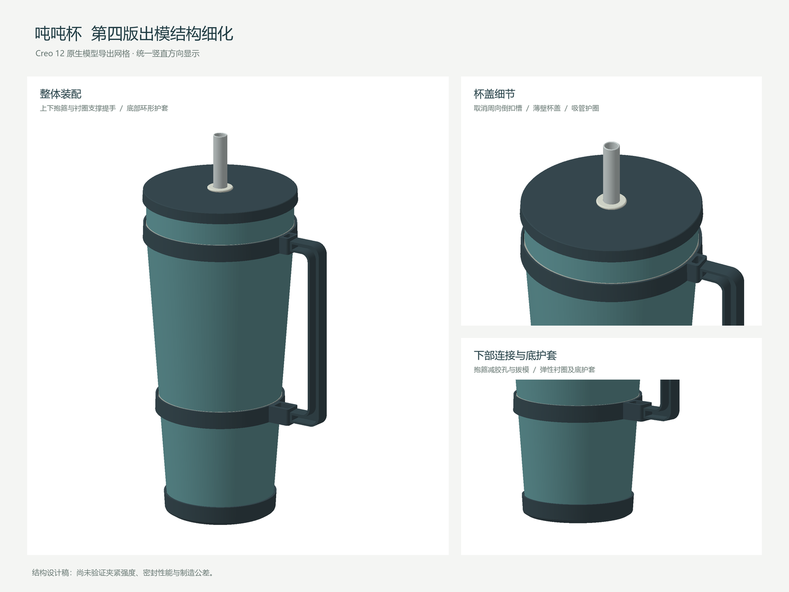

# Codex × Creo 12 后台建模 SKILL

通过 Creo 官方同步 Object TOOLKIT Java 回调，在独立无图形会话中创建原生零件和装配。建模不需要模拟鼠标键盘，用户可继续使用电脑。

## 内容与安装

把 `skills/creo12-background-modeling` 整个目录复制到 `%USERPROFILE%/.codex/skills/`，重新打开会话后使用 `$creo12-background-modeling`。完整操作见 [SKILL.md](skills/creo12-background-modeling/SKILL.md) 与 [连接和运行说明](skills/creo12-background-modeling/references/workflow.md)。

在 Creo 12 中打开 [总装](skills/creo12-background-modeling/assets/models/dundun_cup_mold_v4_final.asm.1)，同目录 11 个 `.prt.1` 均需保留。模型是结构设计稿，含出模改善，不是量产模具图。详见 [模型与出模检查](skills/creo12-background-modeling/references/model-review.md)。

需要本机合法安装与可用许可的 Creo 12、兼容 Java 和 Java 编译器。仓库不包含 PTC 软件和库、第三方运行时、许可或教材 PDF。

封存基线：`v1.0.0`。完整性清单见 `SHA256SUMS.json`。这里的封存指保留版本和标签；仓库保持可维护，未设置 GitHub 只读归档。
